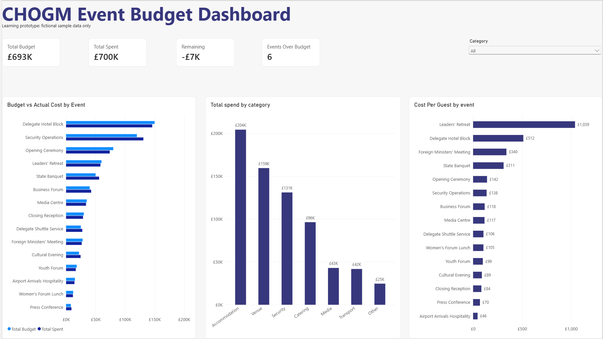

# CHOGM Event Budget Tool

> **Learning prototype: fictional sample data only.** This is not an approved or production system.

A browser-based tool for planning CHOGM event budgets, tracking costs and attendance, and exporting sample data for a Power BI dashboard.

Built as a work placement project for the Commonwealth Events and Protocol Team.

## Purpose

The Events and Protocol Team asked for a small prototype that shows how event planning and budget information could be captured, summarised and presented more consistently in the run-up to CHOGM.

The project has three linked parts:

1. **A website**, where users enter event details and instantly see budget calculations
2. **A dataset**, downloaded from the website as a CSV file
3. **A Power BI dashboard**, which turns that data into charts for managers

## What the tool does

- Add, edit and delete events
- Automatically calculates, for each event:
  - **Variance**: how much over or under budget (in £ and %)
  - **Budget status**: Over or Within
  - **Net cost**: actual cost minus any income
  - **Cost per guest**
  - **Attendance rate**: actual guests compared with expected
- Shows summary totals: total budget, total spent, remaining, and the number of events over budget
- Loads a set of 15 fictional sample events in one click
- Downloads all data as a CSV file, ready for Power BI

## The dashboard shows

- Headline figures: total budget, total spent, remaining, events over budget
- Budget vs actual cost for each event
- Total spending by category
- Cost per guest for each event
- A category filter that updates the whole page

## How to use it

1. Download or clone this repository.
2. Open `index.html` in a web browser (Edge, Chrome or Firefox). No installation is needed.
3. Click **Load sample data**, or add your own events using the form.
4. Click **Download CSV** to save the data.
5. Open `chogm-dashboard.pbix` in Power BI Desktop to view the dashboard.

Live website: *to be added once published through GitHub Pages, subject to supervisor approval.*

See the [User guide](user-guide.md) for full step-by-step instructions.

## Files in this repository

| File | What it is |
|---|---|
| `index.html` | The structure of the web page |
| `style.css` | The look of the page, following Commonwealth branding |
| `script.js` | The calculations and button actions |
| `commonwealth-logo.png` | The Commonwealth logo (blue horizontal version) |
| `chogm-event-data.csv` | The fictional sample dataset |
| `chogm-dashboard.pbix` | The Power BI dashboard |
| `dashboard-screenshot.png` | A picture of the dashboard, for anyone without Power BI |
| `Wireframe.jpeg` | The original sketch of the page layout |
| `requirements.md` | Project requirements, assumptions and priorities |
| `Data-Dictionary.md` | Every data field explained, with calculations |
| `user-guide.md` | How to use the website and dashboard |
| `technical-notes.md` | How the tool is built, and design decisions |
| `test-record.md` | Tests carried out, results and issues found |

## Technologies used

- HTML, CSS and JavaScript (front end only)
- Power BI Desktop
- GitHub for version control and documentation

## Assumptions

- All data is fictional and used for demonstration only.
- All money is in pounds sterling (£).
- One person uses the tool at a time, on their own computer.
- Income is optional, as most CHOGM events are not income-generating.

## Limitations

- **Data is not saved.** Refreshing or closing the page removes all events. This is because the brief requires a front-end-only tool with no database. Download the CSV to keep a copy.
- The dashboard does not update automatically. A new CSV must be downloaded and the dashboard refreshed.
- The tool has not been tested for accessibility to a formal standard.
- This is a learning prototype and must not be used for real CHOGM planning.

## Author

Arjun, work placement student, ICT.
